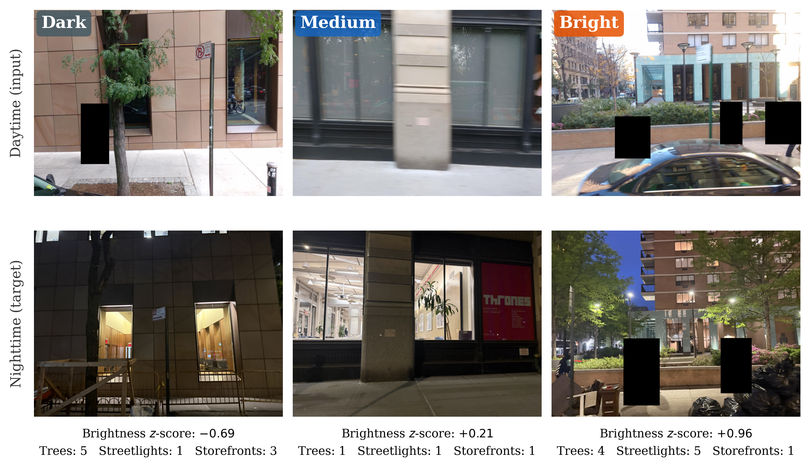
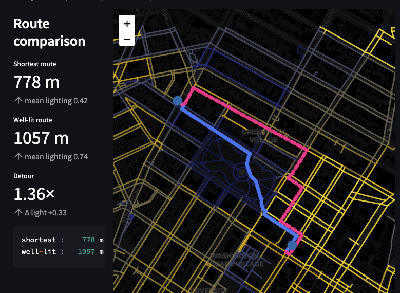

**Course Project for Computer Vision for Science and Engineering (Graduate Level)**  
**Spring 2026**

## Project Overview

This project implements **NightWalk**, a computer vision system that predicts how bright a street will be at night using only a daytime photo. Nighttime street-level imagery is scarce and expensive to collect at scale, which makes it hard to assess how well-lit a city actually is after dark — even though lighting strongly shapes which routes pedestrians feel safe taking. NightWalk sidesteps this by learning to recover nighttime lighting signal directly from daytime visual cues like street lamps, storefronts, and tree canopy.

This was a group project, my main contributions include: co-developing the model's training pipeline, from early prototyping through the final ablation study comparing pretraining strategies (ImageNet, self-supervised learning, and DINO-based feature pretraining), and building the manual tool used to pair daytime and nighttime street images

## Model Pipeline & Findings

NightWalk works in two stages. First, a backbone model is trained to recognize lighting-relevant features — street lamps, storefronts, tree canopy — in daytime images, using labels generated automatically by an open-vocabulary object detector. Second, a brightness-prediction head is attached to that backbone and fine-tuned end-to-end on our 974 paired day–night images, learning to output a single score for how bright a given street will be at night.

  

    
    

      NightWalk pipeline: feature detection → brightness prediction
    

  

We first tested whether object counts alone (e.g., "how many streetlights are visible") could predict nighttime brightness. They couldn't — a linear baseline on these counts explained almost none of the variation (R² = 0.08). This motivated the full visual model, which explains nearly half the variance (R² = 0.46), showing that daytime images do contain real signal about nighttime lighting, but it's embedded in the full scene rather than reducible to simple counts.

We also ran a controlled ablation comparing backbone initializations — standard ImageNet pretraining, self-supervised pretraining on our own street images, and our custom lighting-feature pretraining — to see whether task-specific pretraining would give the model a head start. Counterintuitively, it didn't: standard ImageNet initialization performed best, suggesting that at this dataset size, general-purpose visual features transferred better than features tuned specifically for counting lighting objects.

  

    
    

      Dark, medium, and bright predictions vs. ground truth
    

  

Finally, we built a prototype route planner for Greenwich Village that uses NightWalk's predictions as edge weights in a walking graph, recommending better-lit paths at the cost of a modest detour — demonstrating a concrete downstream use for the model's predictions.

  

    
    

      Shortest path vs. well-lit path, Greenwich Village
    

  

---