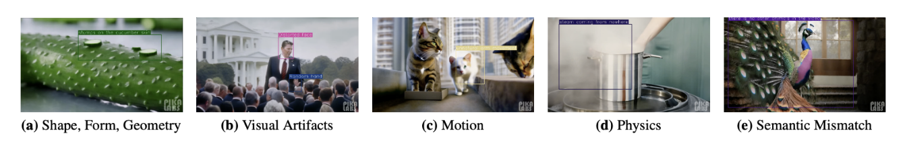
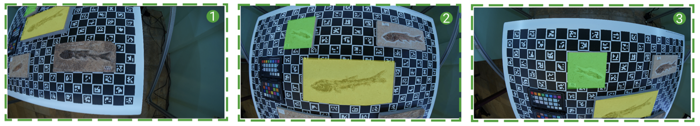
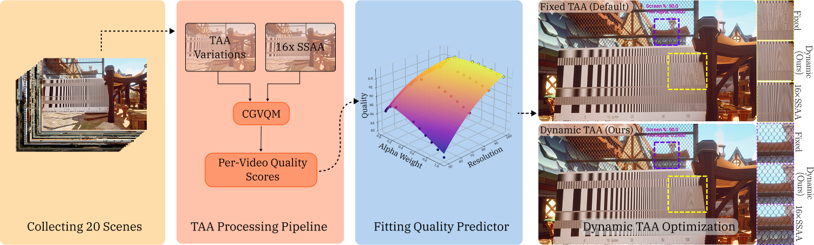

<h3 style="margin-bottom: 1rem;">GeneVA: A Dataset of Human Annotations for Generative Text to Video Artifacts</h3>

  
  
Our Artifact Taxonomy

Kang, J., <strong>Silva, M. B.</strong>, Sangkloy, P., Chen, K., Williams, N., & Sun, Q. (arXiv Preprint, 2025)

Accepted to Winter Conference on Applications of Computer Vision (WACV) 2026

  <a href="https://arxiv.org/abs/2509.08818" style="margin-right: 1.5rem; text-decoration: none;">📝 arXiv</a>
    <a href="https://youtu.be/toQTET43f9I" style="margin-right: 1.5rem; text-decoration: none;">🎥 Video Presentation</a>

<strong>Abstract:</strong> The first large-scale dataset of human-annotated artifacts in AI-generated videos, containing 16,451 annotations across 16,356 videos with per-frame bounding boxes, descriptions, and quality ratings. This work addresses the critical need for human-in-the-loop feedback for generative video models.

<strong>My Contributions:</strong>

<ul style="margin-left: 1.5rem; margin-top: 0; font-size: 0.95rem;">
  <li>Designed and implemented the complete data acquisition pipeline, developing a custom Python system to extract videos from 2.7TB dataset under HPC storage constraints </li>
  <li>Conducted video analysis and literature review that informed the artifact taxonomy development</li>
  <li>Proposed key study design decision to show prompts to annotators, enabling measurement of both prompt-video alignment and artifact perception</li>

</ul>

<h3 style="margin-bottom: 1rem;">PaleoScan: Low-Cost Easy-to-use High-Volume Fossil Scanning</h3>

  

Silva, C., Piadyk, Y., Rulff, J., Panozzo, D., <strong>Silva, M. B.</strong>, et al. (2024)

ACM CHI Conference on Human Factors in Computing Systems

  <a href="https://dl.acm.org/doi/10.1145/3613904.3642020" style="margin-right: 1.5rem; text-decoration: none;">📄 Paper</a>
  <a href="https://www.youtube.com/watch?v=4UFOLQ2PPv4" style="margin-right: 1.5rem; text-decoration: none;">🎥 Video Preview</a>
  <a href="https://www.youtube.com/watch?v=ZBupqi6NLog" style="margin-right: 1.5rem; text-decoration: none;">💻 Full Video Presentation</a>

<strong>Abstract:</strong> PaleoScan presents a low-cost, accessible 3D scanning system designed for high-volume fossil digitization in resource-limited paleontological institutions, democratizing access to advanced scanning technology.

<strong>My Contributions:</strong>

<ul style="margin-left: 1.5rem; margin-top: 0; font-size: 0.95rem;">
  <li>Collaborated with paleontologists in Brazil to understand workflows and system requirements</li>
  <li>Helped conceptualize the interface design for PaleoDP, the data processing and annotation pipeline</li>
  <li>Directed and produced the video submission</li>
  <li>Co-presented the paper at ACM CHI 2024</li>
</ul>

 

 
<h3 style="margin-bottom: 1rem;">Tuning for Perception: A Visual Quality Study for Temporal Anti-Aliasing</h3>
 

  

 

<strong>Silva, M. B.</strong>, Chen, K., Groth, C., Sun, Q., Kaplanyan, A., & Jindal, A. (2026)

 

Manuscript in preparation (available upon request). Honors thesis, NYU Courant. In collaboration with Intel.

 

<strong>Abstract:</strong> Temporal anti-aliasing (TAA) is standard in real-time rendering, but its parameters are usually tuned by heuristics rather than by what people actually see. We systematically vary TAA parameters across scenes and use perceptual quality metrics to identify which rendering choices most affect perceived visual quality, as a step toward tuning TAA directly for human perception.

 

<strong>My Contributions:</strong>

<ul style="margin-left: 1.5rem; margin-top: 0; font-size: 0.95rem;">
  <li>Designed and executed the full study as lead author (honors thesis)</li>
  <li>Built a scripted rendering pipeline in Unreal Engine generating 2,000+ videos across 10 scenes and 28 TAA parameter configurations</li>
  <li>Built the Python evaluation pipeline around perceptual quality metrics to isolate which parameters most affect perceived quality</li>
</ul>
 

 

<h2> Presentations </h2>

<strong>ACM CHI 2024</strong> — Honolulu, Hawaii 
Co-presented <em>PaleoScan: Low-Cost Easy-to-use High-Volume Fossil Scanning</em> 
May 2024

  <!-- closes top spacing div -->

